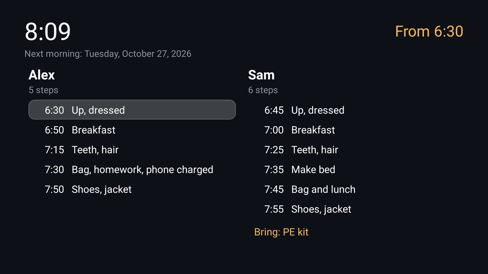

# Morning Board

What to do next on a school morning, on the TV: a large clock and how long until you leave, then a column per kid with
the morning's steps and their times. The step under way is highlighted, and the kids tick steps off with the remote.
For the [Clean Your TV](../../README.md) launcher it declares a [module card](../../docs/modules.md): once you
answer **Show card** its tile reads "Morning" with an amber glow. On any other Android TV home it is an ordinary app.



| On the board | With the remote |
|---|---|
| The clock, and "Leave in 23 min", then "Time to go!" | |
| A column per kid (up to four): their name, how many steps are done, and the steps | ◀ ▶ moves between kids, ▲ ▼ between steps |
| The step whose time has come, in amber; earlier ones dimmed | OK ticks a step off, or back on |
| That day's extras under each column ("Today: PE kit") | |

Every step has a box, and OK ticks it at any time: outside the routine's window the board shows the next morning's
plan, and a step ticked then (a bag packed the night before) counts for that morning. Ticks are gone the morning after.

## The routine

One JSON file, pushed from a computer (`example-routine.json` is a full one):

```json
{
  "days": ["MON", "TUE", "WED", "THU", "FRI"],
  "from": "6:30", "until": "8:10", "leave": "8:00",
  "showOnWake": true,
  "kids": [
    { "name": "Sam",
      "steps": [{ "at": "6:45", "do": "Up, dressed" }, { "at": "7:00", "do": "Breakfast" }],
      "extras": { "TUE": ["PE kit"] } }
  ]
}
```

| Field | Meaning |
|---|---|
| `days` | The days the routine runs: `MON` … `SUN` |
| `from`, `until` | The window, in 24-hour `H:mm` |
| `leave` | When everyone leaves, inside the window; the countdown runs to it |
| `showOnWake` | `true` opens the board by itself when the TV is switched on, or boots, inside the window. Off when left out |
| `turnTvOn` | `true` switches the TV on at `from` and opens the board, and puts the TV back to standby at `until` if the board is still on screen (a show someone started is left playing). Off when left out. **Not on a Sony BRAVIA**: there an app's wake from deep standby turns Android on but leaves the panel dark, so a press of the power button then turns the TV off; use the TV's own on-timer instead (below) |
| `kids` | One to four, each a `name`, its `steps` (`at` inside the window, one step a time, and `do`) and optional `extras` by day |
| `email` | Optional: `to` (a list of addresses) and `reportAt` (inside the window; `leave` when left out). An email goes to them once a kid ticks every step inside the window, and at `reportAt` one listing what is still unticked, if anything. Needs a `mail.json` (below) |
| `greeting` | Optional: the heading a kid's column gets once every step is ticked, in place of the name, with `{name}`, e.g. `"Good morning {name}! I love you ♥"`. The name alone when left out |
| `music` | Optional: `uri` (a `spotify:playlist:…`), `device` (the TV's Spotify Connect name, e.g. `"Living Room TV"`), `until` (when it pauses), and for a wake-up ramp `startVolume`, `rampEveryMinutes`, `rampStep` and `maxVolume` (percent; 60 when left out). Needs a `spotify.json` (below) |

The board makes its own sounds: a two-note chime when a step comes due, and a happy run up a chord when a box is
ticked.

With `music`, once a morning when the screen comes on inside the window, the board opens Spotify on the TV, waits for
its Connect device, and starts the playlist through Spotify's Web API (Spotify's TV app will not start a playlist for
another app on the TV itself), then sets `startVolume`. Every `rampEveryMinutes` it chimes and turns the TV up by
`rampStep`, never past `maxVolume`, until anyone ticks a box. The volume is stepped one notch at a time, because a
Sony BRAVIA moves a single step for each change it is asked for. `spotify.json` is the account it plays on, which
needs Spotify Premium: `{"clientId", "clientSecret", "refreshToken"}`, from a
[Spotify developer app](https://developer.spotify.com/dashboard) and one sign-in with the scopes
`user-read-playback-state user-modify-playback-state`. Keep it out of the repo, like `mail.json`.

The emails go out through your own mail account, pushed as a second file that stays out of the routine and out of
the repo: `{"host": "smtp.gmail.com", "port": 465, "user": "you@example.com", "password": "<app password>"}`, SMTP
with TLS on connect. For Gmail the password is an [app password](https://myaccount.google.com/apppasswords). A send
that fails says why on the board.

To have the board up when everyone comes down, let the TV's own on-timer switch it on at `from`, with `showOnWake`
on. A Sony BRAVIA's (Settings → Timers & Clock → Timer: Every Mon-Fri, the time, a duration, an input) switches to
its input a second after waking, over the board, and again some 20 seconds in; the board comes back on top each
time, since it opens again several times in the first minute after the screen turns on inside the window.

A file that breaks any of these is refused: the install script stops with the reason, the board shows it, and the
routine already on the TV stays. While the window is open the board keeps the screen on, so the screensaver does not
cover it. Keep your own routine outside the repo: it names your children.

## Build and install

JDK 17 and Android SDK platform 34 with build-tools 34.0.0, as for the launcher, and the `tools/venv` from the main
README. The `gradlew` scripts reuse the launcher's pinned Gradle wrapper with this folder as the project.

```bash
TV_HOST=<tv ip> addons/morning-board/build-and-install.sh [routine.json [mail.json [spotify.json]]]
```

```powershell
addons\morning-board\build-and-install.ps1 -TvHost <tv ip> [-Routine routine.json] [-Mail mail.json] [-Spotify spotify.json]
```

Run it again with a new routine to change it; `--uninstall` (`-Uninstall`) removes the app. To build only:
`cd addons/morning-board && ./gradlew assembleRelease`; the JVM tests run with `./gradlew testReleaseUnitTest`.

## Permissions

| Permission | Why |
|---|---|
| `FOREGROUND_SERVICE`, `FOREGROUND_SERVICE_SPECIAL_USE` | Only for `showOnWake`: a service that hears the screen turn on. It stops itself when the routine does not ask for it. |
| `RECEIVE_BOOT_COMPLETED` | Starts that service again after a reboot, and opens the board when the TV boots inside the window. |
| `SCHEDULE_EXACT_ALARM`, `WAKE_LOCK` | Only for `turnTvOn`: alarms on the minute the window opens and closes, and the screen switched on with the first. |
| Accessibility service (`SleepService`) | Only for `turnTvOn`'s standby at the end of the window: the "lock screen" action, which on Android 9 and later puts the TV to sleep, as Sleep Timer's does. It asks for no events and reads nothing on screen. The install script enables it. |
| `SYSTEM_ALERT_WINDOW` | Android 10 and later let an app open its screen from the background only with it; the install script grants it. Not needed on Android 9. |

| `INTERNET` | Only for `email` and `music`: the mail server in `mail.json` and Spotify's Web API, and nothing else. |

No accounts beyond your own mail server, no telemetry, no libraries. The routine and the ticks stay in the app's own storage (backups are off).
`ConfigProvider` takes a pushed file and answers whether it was taken, and only the ADB shell can use it (it requires
`WRITE_SECURE_SETTINGS`, as Smart Home's does).

## Tested on

Sony BRAVIA XBR-65X900E (Android TV 9), on the cleanyourtv launcher: installed with `build-and-install.ps1`, the card
shown after **Show card**, the board showing the next morning's plan outside the window (the screenshot, with
`example-routine.json`), a routine pushed and taken, and the screen watcher running as a foreground service. The JVM
tests cover the schedule (the window, which morning is shown, the step under way, the countdown) and the routine's
refusals.

## Maintainer

[@hugoforte](https://github.com/hugoforte)
